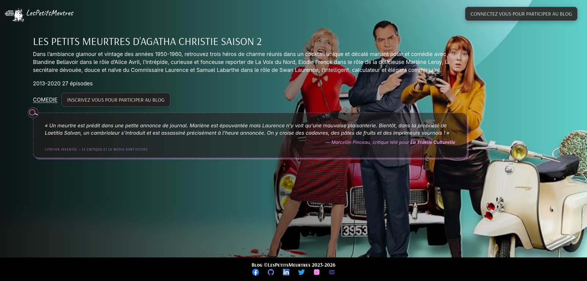

# DUMMY APP FOR LEARNING PURPOSES

**This is dummy django blog application.**

In the cloud context, application is hosted on [Render](https://render.com/) as a Python app, so Docker, Gunicorn, Nginx are not used.

Locally you will run the application using Docker (with Gunicorn and Nginx).

The CI-CD chain consists in using [Circle-ci](https://circleci.com/).

A dummy Django application for learning purposes, to practise. All the front-end styling was adapted from an existing source and laid out using Vibe Mistral AI.

You can find this dummy blog app at https://dummy-django-app-on-render.onrender.com/

**Because of a free instances plan, Render will spin down with inactivity, which can delay requests by 50 seconds or more.**

## TECHNOLOGIES
---------------
Python 3.14.8

Sqlite3

Gunicorn

Nginx

Docker (docker-compose), DockerHub

Circle-CI

Coveralls

Twilio SendGrid

Betterstack

# HOW USE IT ?
    git clone https://github.com/memphis-tools/dummy_django_app_on_render.git

    cd dummy_django_app_on_render

    poetry install

    source $(poetry env info --path)/bin/activate

## EXECUTION PREQUISITES
For a **local** usage set a .env file such like this :

    export RUNNING_ENV='dev|prod|test'
    export DEBUG=0
    export SECRET_KEY="superSecretKey"
    export ALLOWED_HOSTS="localhost,127.0.0.1"
    export TIME_ZONE="Europe/Paris"
    export DOCKER_HUB_USER='yourDockerhubUsername'
    export DOCKER_HUB_PASSWORD='yourDockerhubPassword'
    export AWS_ACCESS_KEY_ID="your_aws_access_key_id"
    export AWS_SECRET_ACCESS_KEY="your_aws_secret_access_key"
    export AWS_DEFAULT_REGION="your_aws_region"
    export SENDGRID_API_KEY="yourSendGridApiKey"
    export EMAIL_HOST="smtp.sendgrid.net"
    export EMAIL_PORT=587
    export EMAIL_USE_TLS=True
    export DEFAULT_FROM_EMAIL="theFromValue"
    export DEFAULT_TO_EMAIL="aValidSendGridSenderEmail"
    export EMAIL_HOST_USER=apikey
    export EMAIL_HOST_PASSWORD=$SENDGRID_API_KEY
    export BETTERSTACK_SOURCE_TOKEN="yourBetterstackSourceToken"
    export BETTERSTACK_INGESTING_HOST="yourBetterstackIngestionHostURL"
    export SITE_URL=""

EMAIL_HOST_USER=apikey mandatory for SendGrid usage.

SITE_URL="https://dummy-django-app-on-render.onrender.com" (for example).

The Django settings.py will load the file (with load_dotenv).

## TO RUN IT
To avoid manual commands, use the dummy "docker-compose-deployment.sh".

To build the images locally:

    ./docker-compose-deployment.sh build

To publish the built images on Dockerhub:

    ./docker-compose-deployment.sh publish

To run the local images or run the Dockerhub images (think about publish first) and stop app:

    ./docker-compose-deployment.sh run

    ./docker-compose-deployment.sh down

Notice: the './docker-compose-deployment.sh cloud' command is only run by Render.

Once running locally, you can access the application at: http://localhost:5555/

## TO TEST IT

    source .env

    source .venv/bin/activate

    coverage run -m pytest dummy_django_blog/

    coverage report
